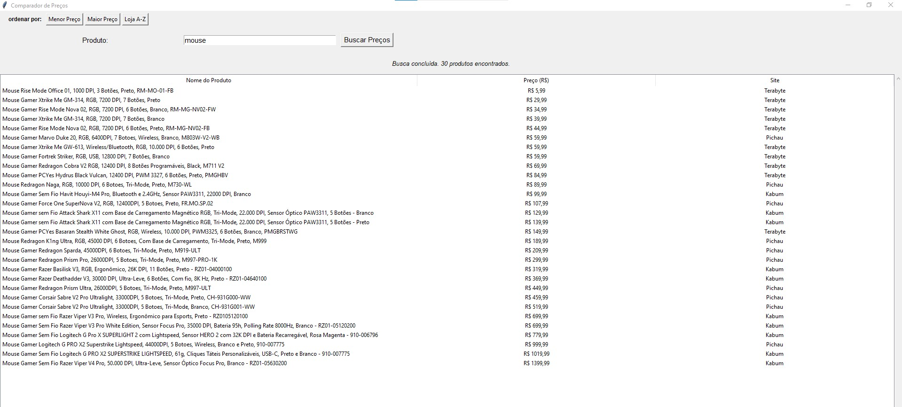

# 🖥️ HardCompare - Comparador de Preços de Hardware

Um aplicativo desktop desenvolvido em Python com interface gráfica (Tkinter) e automação web (Selenium) para comparar preços de componentes e acessórios de PC em tempo real nas principais lojas do Brasil (**Terabyte**, **Pichau** e **Kabum**).

---

## 🚀 Funcionalidades

- **Busca Simultânea:** Pesquise por um componente (ex: *"RTX 4060"*, *"Ryzen 5"* ou *"SSD NVMe"*) e consulte múltiplas lojas de uma só vez.
- **Interface Assíncrona (Threading):** A interface gráfica não trava enquanto o robô realiza a varredura nos sites.
- **Bypass de Anti-Bot (Cloudflare):** Utiliza `undetected-chromedriver` e injeção de CDP para contornar proteções de segurança dos e-commerces.
- **Tabela Interativa (`Treeview`):**
  - **Links Clicáveis:** Clique no nome de qualquer produto para abri-lo diretamente no navegador padrão.
  - **Cursor Dinâmico:** O mouse muda para o formato de "mãozinha" ao passar sobre os itens clicáveis.
- **Filtros de Ordenação:** Ordene os resultados rapidamente por **Menor Preço**, **Maior Preço** ou por **Loja (A-Z)** mantendo a integridade dos links.
- **Arquitetura Modular:** Desenvolvido com Padrão Strategy (Clitando a adição de novos scrapers futuramente.

---

## 📸 Demonstração

🛠️ Tecnologias Utilizadas

- Python (Linguagem principal)
- Selenium & Undetected-Chromedriver (Web Scraping e automação de navegador)
- Tkinter & TTK (Interface gráfica desktop)
- Webdriver Manager (Gerenciamento automático de drivers)

---

📂 Estrutura do Projeto

comparador-precos/
├── src/
│   ├── __init__.py
│   ├── gui.py          # Interface gráfica (Tkinter, tabela e
│   ├── scrapper.py     # Lógica de scraping (Terabyte, Pichau, Kabum)
│   └── main.py         # Ponto de entrada da aplicação
├── requirements.txt    # Dependências do projeto
├── .gitignore          # Arquivos ignorados pelo Git
└── README.md           # Documentação do projeto

---

⚙️ Como Instalar e Rodar o Projeto

Pré-requisitos

Certifique-se de ter o Python instalado no seu computador, além de um navegador compatível com Chromium (Google Chrome ou Brave).

Passos para execução:

1. Clone o repositório:
git clone https://github.com/SEU-USUARIO/comparador-precos.git
cd comparador-precos
2. Crie e ative um ambiente virtual:
python -m venv venv
# No Windows (PowerShell):
.\venv\Scripts\Activate
3. Instale as dependências:
pip install -r requirements.txt
4. Execute a aplicação:
python -m src.main

---

💡 Próximos Passos / Melhorias Futuras

- [ ] Adicionar novas lojas (Ex: Mercado Livre, Amazon).
- [ ] Salvar histórico de buscas em banco de dados SQLite.
- [ ] Gráfico de histórico de variação de preços.

---

👤 Autor

Feito por Otavio Beloto
